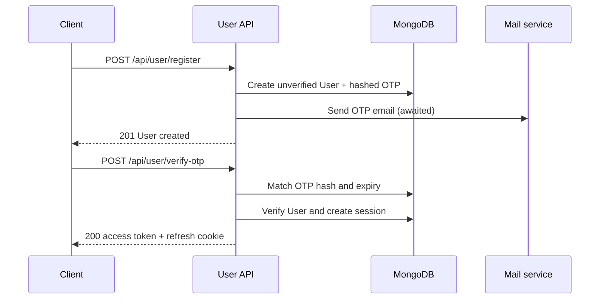
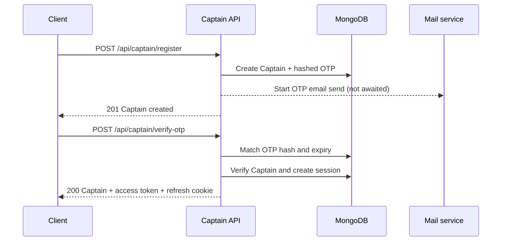

# Authentication

User and Captain authentication share the `Session` and `OTP` Mongoose models, but the routes and account data are separate. A Captain login endpoint and Captain refresh/logout endpoints are **not implemented**.

## User registration and OTP verification

1. `POST /api/user/register` validates the name, email, and password.
2. If the email belongs to a verified User, registration returns `409`. If it belongs to an unverified User, the registration middleware deletes that User's OTP and account, then allows a fresh registration.
3. The User model hashes the password with `bcryptjs` using 12 rounds.
4. The controller generates a six-digit OTP, stores its SHA-256 hash with an expiry five minutes in the future, and awaits the OTP email send.
5. `POST /api/user/verify-otp` hashes the submitted OTP and searches for a matching email/hash with `expiresAt > now`.
6. On success, the User is marked verified, OTP entries for the email are deleted, a session is created, and access/refresh tokens are issued.

## Captain registration and OTP verification

1. `POST /api/captain/register` validates Captain details and vehicle data.
2. A verified Captain with the same email is rejected with `409`. If an unverified Captain exists, the middleware deletes that Captain's OTP and account before continuing.
3. The Captain model hashes the password with `bcryptjs` using 12 rounds.
4. An OTP hash is stored with a five-minute expiry. The controller calls the OTP email service without `await`; email delivery completion is **not confirmed** before it returns `201`.
5. `POST /api/captain/verify-otp` checks the OTP hash and expiry, marks the Captain verified, creates a session with role `captain`, and returns an access token.

Captain and User share the OTP collection. The OTP schema field is named `user`; Captain verification stores and uses the Captain's ID in that field.

## OTP details

- OTP generation uses `crypto.randomInt(100000, 1000000)`, producing a six-digit decimal value.
- Only a SHA-256 hash is stored in MongoDB.
- Both verification controllers check that `expiresAt` is later than the current time.
- OTP lifetime is five minutes.
- The OTP schema has no TTL index; expired records are removed only by successful verification or registration cleanup, not automatically on expiry.
- The OTP schema has a unique email field. No resend-OTP endpoint, attempt counter, or rate limit is implemented.
- Invalid/expired OTP response differs: User verification returns `400`; Captain verification returns `401`.

## Password storage and verification

- User and Captain passwords are hashed in their Mongoose `pre("save")` hooks with `bcryptjs` and 12 rounds.
- User and Captain models define `comparePassword` methods using `bcrypt.compare`.
- User login calls `comparePassword`; a Captain login route that would use the Captain method is **not implemented**.
- The Captain schema does not mark its password field `select: false`, and its registration/OTP controllers return the full Captain document. As currently implemented, that document includes the bcrypt password hash. This is sensitive data and should not be exposed in production responses.

## Tokens and session storage

The token utility signs:

| Token | JWT payload generated by the code | Secret / lifetime source |
| --- | --- | --- |
| Access token | `{ "userId": "...", "sessionId": "...", "role": "user" \| "captain" }` | `JWT_ACCESS_SECRET`, `ACCESS_TOKEN_EXPIRY` |
| Refresh token | `{ "userId": "..." }` | `JWT_REFRESH_SECRET`, `REFRESH_TOKEN_EXPIRY` |

JWT standard claims such as `iat` are added by `jsonwebtoken`. Expiration is controlled by the corresponding environment variable; the app does not validate the token-expiry variables at startup.

The shared `Session` model stores:

- `user`: the User or Captain MongoDB ID
- `refreshTokenHash`: SHA-256 hash of the refresh token
- `ip` and `userAgent`
- `role`: `user` or `captain`
- `revoked`, defaulting to `false`
- Mongoose timestamps

The plaintext refresh token is sent only in the HttpOnly cookie. The database stores its hash. Refresh-token validation looks up a session by account ID, token hash, and `revoked: false`. User refresh rotates the stored hash and issues a new access token; its role comes from the session, with `"user"` as a fallback. Captain refresh is **not implemented**.

## Cookie behavior

The cookie is named `refreshToken`, is `HttpOnly`, has a seven-day `maxAge`, and uses `Path=/api/user`. `Secure` and `SameSite` vary by `NODE_ENV` as described in [API Overview](./API-OVERVIEW.md#refresh-token-cookie).

Captain OTP verification also sets this cookie with `Path=/api/user`. The cookie is therefore not scoped to `/api/captain`.

The clear-cookie service omits the configured path when clearing the cookie. Whether the browser removes the cookie is **not confirmed**.

## Session revocation

- User logout marks the current session `revoked: true`.
- User logout-all marks all non-revoked sessions for the User ID as revoked.
- User refresh and logout routes require the refresh-token cookie and a matching non-revoked session.
- Captain logout and session revocation routes are **not implemented**.

## Middleware and implementation limitations

- User registration middleware handles verified duplicates and replaces an existing unverified User and their OTP before a new registration.
- Captain registration middleware applies the analogous behavior to Captains.
- `requireUserRefreshSession` verifies the refresh JWT and checks the active session.
- `userAccessSessionMiddleware` extracts the second whitespace-separated segment from `Authorization`; it does not explicitly validate the `Bearer` scheme. It verifies the JWT, but the session query is not awaited and does not filter `revoked: false`. As a result, a live session check is **not confirmed in code**.
- Invalid access JWT exceptions are forwarded to the global error middleware, which defaults to HTTP `500`, not `401`.
- No Captain access-token middleware is implemented.
